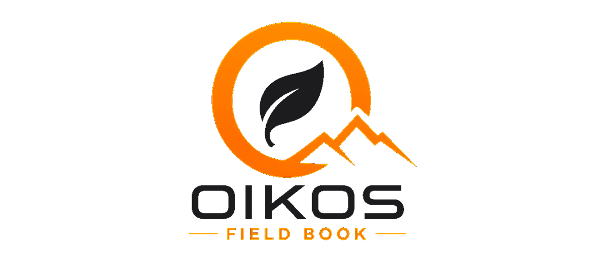
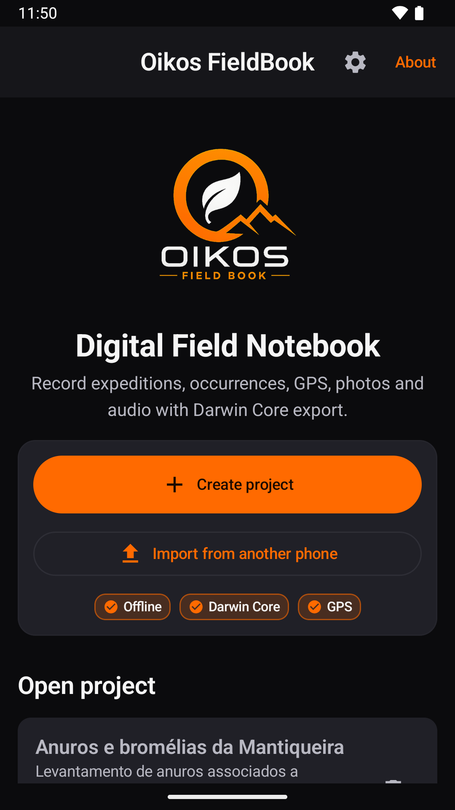
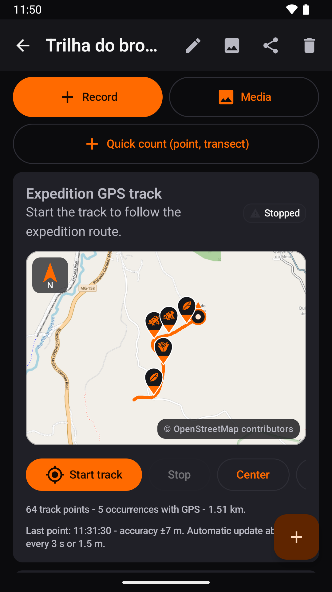
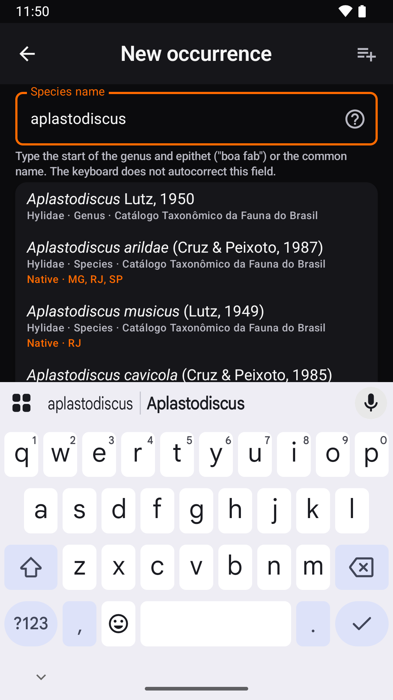
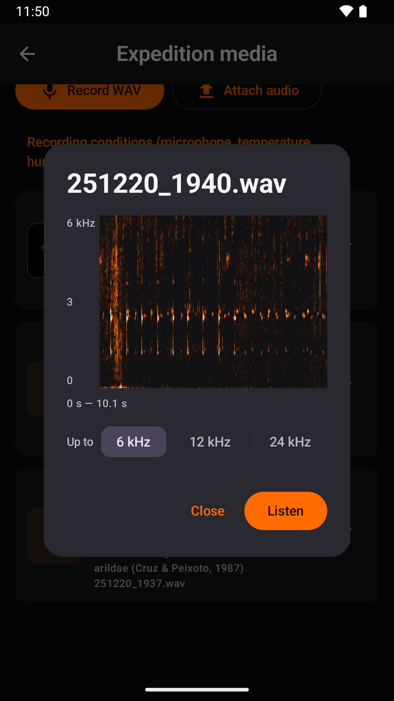

<p align="center">
  <picture>
    <source media="(prefers-color-scheme: dark)" srcset="app/src/main/res/drawable-nodpi/oikos_brand_logo.png">
    
  </picture>
</p>

<p align="center">
  A digital field notebook for biodiversity, for Android.<br>
  Expeditions, occurrences, coordinates, tracks, photos and audio, offline, with Darwin Core export.
</p>

<p align="center">
  <a href="https://github.com/LuanCortesM/oikos-fieldbook/actions/workflows/ci.yml"></a>
  <a href="https://doi.org/10.5281/zenodo.20526746"></a>
  <a href="LICENSE"></a>
</p>

<p align="center">
  <a href="https://play.google.com/store/apps/details?id=com.oikos.fieldbook">Google Play</a> ·
  <a href="https://luancortesm.github.io/oikos-fieldbook/privacidade/">Privacy policy (Portuguese)</a> ·
  <a href="README.md">Português</a>
</p>

---

Oikos FieldBook is a field notebook for people who survey fauna, flora and fungi. In the field, you record the expedition, the individuals you find, photos and sound recordings. Back at the desk, you export everything as a spreadsheet, a Darwin Core Archive or GeoJSON, with no retyping.

The app works offline and has no account and no server. Your data stays on the phone until you decide where to send it.

<p align="center">
  
  
  
  
</p>

## In the field

- **Projects and expeditions.** Each project sets the groups it studies (fauna, flora, fungi) and the fields it uses, from a catalogue of more than 150 Darwin Core terms with controlled vocabularies. An expedition stores date, place, team, habitat and sampling effort, and maps to the Darwin Core `Event`.
- **Records.** Occurrences with species, count, photos, audio and notes. A quick count covers point and transect counts.
- **GPS.** The app averages several readings and works out the uncertainty. Altitude is converted to height above sea level with the EGM2008 geoid, and the municipality and state come from the IBGE boundaries, all computed on the phone. The datum can be SIRGAS 2000 or WGS84, and coordinates can be shown and typed as decimal degrees, DMS, DMM or UTM.
- **Track.** The expedition route keeps recording with the screen off. Tracks from handheld GPS units can be imported as GPX, KML, GeoJSON or CSV. The map comes from OpenStreetMap or from an MBTiles file for areas with no signal.
- **Photos and audio.** The camera opens inside the app. Audio is recorded as uncompressed WAV (44.1 kHz, 16-bit) and can be checked on a spectrogram. Photos and recordings from other devices can be attached, and the app reads their date and the camera or recorder model.
- **Offline species lists.** The Flora e Funga do Brasil and the Catálogo Taxonômico da Fauna do Brasil ship with the app. They suggest names and show synonyms, common names and distribution by state. The lists can be updated from within the app.

## After the field

- **Export.** The app produces CSV (international style or Brazilian Excel style), XLSX, JSON and GeoJSON for QGIS. It also produces a ZIP with spreadsheets and media, and a Darwin Core Archive (`meta.xml` and `eml.xml`), the format used to publish data to GBIF and SiBBr. Extra measurements go out as `MeasurementOrFact`. Whatever the app language, columns and vocabulary values follow the Darwin Core standard.
- **Herbarium specimen labels** as PDF, with a QR code for each record.
- **Backup and phone-to-phone transfer.** A full backup (database, photos and audio) goes into a single file. A project can move to another phone as a file or straight to the phone next to you, with no internet, and the app first shows what is new and what conflicts.
- **Trash.** Deleted items stay for 30 days before they are removed.
- **Citation.** The About screen gives the reference in ABNT, Vancouver and APA styles, and every export includes a `COMO_CITAR.txt` file.
- **Languages.** Portuguese, English and Spanish.

There are no ads, no analytics and no tracking. The internet is used only for the online map, for downloading species lists and, if you turn it on, for address suggestions from Google. Details are in the [privacy policy](https://luancortesm.github.io/oikos-fieldbook/privacidade/) (in Portuguese).

## Install

The app is on [Google Play](https://play.google.com/store/apps/details?id=com.oikos.fieldbook) and runs on Android 8.0 or newer. The code in this repository may be slightly ahead of the version in the store.

## Build

You need JDK 21 or newer (the one bundled with Android Studio works) and the Android SDK 36.

```bash
./gradlew assembleDebug                # APK in app/build/outputs/apk/debug/
./gradlew testDebugUnitTest            # unit tests
./gradlew connectedDebugAndroidTest    # tests on an emulator or phone
```

The store build is signed only if `signing/keystore.properties` exists, with `storeFile`, `storePassword`, `keyAlias` and `keyPassword`. Without it, the release build is unsigned. The `signing/` folder never goes into the repository.

## Code layout

Kotlin, with Jetpack Compose screens and a Room (SQLite) database, under `app/src/main/java/com/oikos/fieldbook/`:

| Folder | Contents |
|---|---|
| `data` | Database: entities, queries and migrations (schemas in `app/schemas`) |
| `dwc` | Darwin Core term catalogue, with Portuguese, English and Spanish labels |
| `export` | CSV, XLSX, JSON, GeoJSON, ZIP, Darwin Core Archive, labels and citation |
| `services` | GPS, background track recording, photos and audio, offline map, trash and phone-to-phone transfer |
| `geo` | Municipality from the IBGE boundaries, EGM2008 geoid and coordinate checks |
| `checklist` | Species lists: parsing, search, groups and map icons |
| `audio` | Spectrogram |
| `backup` | Full app backup |
| `ui` | Translated strings, theme and screen components |
| `util` | Coordinates, language and storage |

The screens live in `MainActivity.kt`. Tests are in `app/src/test` (unit) and `app/src/androidTest` (device).

## Data bundled with the app

| File in `app/src/main/assets` | Source | Built by |
|---|---|---|
| `municipios.bin` | IBGE, Malha Municipal 2022 (CC BY 4.0) | `tools/ibge/MalhaMunicipal.java` |
| `geoide_egm2008.bin` | NGA EGM2008 model, from the GeographicLib 5' grid | `tools/geoide/GeoideEgm2008.java` |
| `listas/flora_brasil.zip` | Flora e Funga do Brasil, JBRJ (CC BY 4.0) | `tools/listas/ListasEmbutidas.java` |
| `listas/fauna_brasil.zip` | Catálogo Taxonômico da Fauna do Brasil (CC BY 4.0) | `tools/listas/ListasEmbutidas.java` |
| `licencas/google_play_services.txt` | Third-party notices from Google Play services | `tools/licencas/AvisosPlayServices.java` |

The header of each generator explains where to download its source and how to run it (in Portuguese). Map icons are built from `tools/icones` and the launch screen from `tools/splash`.

## How to cite

> Maciel, L. S. C. (2026). *Oikos FieldBook* (Version 0.2.3) [Computer software]. Zenodo. https://doi.org/10.5281/zenodo.20526746

The DOI covers all versions and always resolves to the latest one. The app's About screen also gives the ABNT and Vancouver references, with the access date filled in. GitHub's "Cite this repository" button reads [`CITATION.cff`](CITATION.cff).

## License

The code is licensed under the [Apache License 2.0](LICENSE).

The following are not covered by it and remain all rights reserved by the author: the Oikos FieldBook name, the logo and the app's drawings, namely:

- the logos and icons in `app/src/main/res/drawable-nodpi/` and `app/src/main/res/drawable/ic_oikos_notification.xml`;
- the hiker and the Itaguaré outline, in every file derived from them (`app/src/main/res/drawable/trilheiro.xml`, `app/src/main/res/drawable/itaguare_contorno.xml`, `tools/splash/` and `docs/privacidade/.itaguare_path.txt`);
- the drawings in `tools/icones/desenhos/` and `tools/icones/svg/`;
- the images in `docs/`.

Third-party data bundled with the app keeps its own license, listed in [`NOTICE`](NOTICE).

## Issues and ideas

Open an [issue](https://github.com/LuanCortesM/oikos-fieldbook/issues) or use the "Report a problem or share an idea" button in the app, which drafts an email to herpetomantiqueira@gmail.com.

## Credits

Developed by Luan da Silva Cortes Maciel (Maciel, L. S. C.), Projeto Herpeto Mantiqueira. The app is the technical product of the author's professional master's degree in Biodiversity in Protected Areas (Biodiversidade em Unidades de Conservação) at the Escola Nacional de Botânica Tropical, Rio de Janeiro Botanical Garden Research Institute (JBRJ). Supervised by Leandro Freitas and co-supervised by Matheus de Toledo Moroti. The app is linked to the research project "Levantamento e Interações Ecológicas entre Anuros e Bromélias na RPPN Gigante do Itaguaré" (survey of frogs and bromeliads and their ecological interactions in the Gigante do Itaguaré private reserve).

Map: © [OpenStreetMap](https://www.openstreetmap.org/copyright) contributors.
