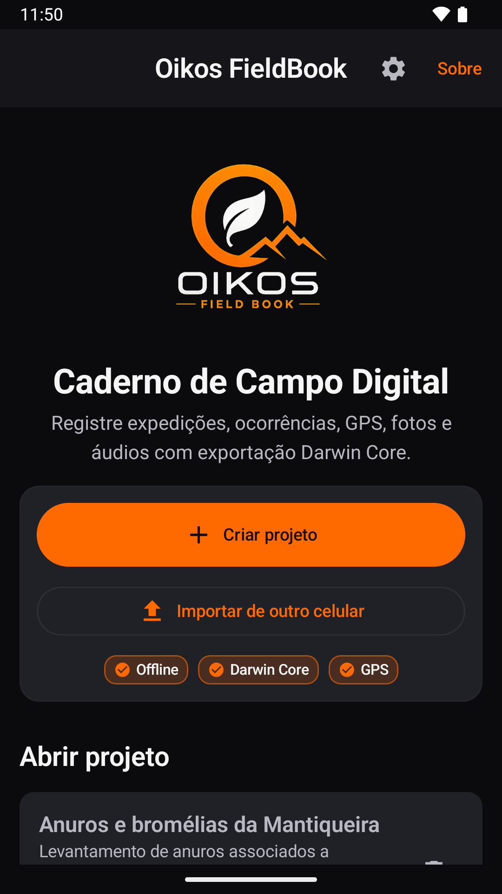
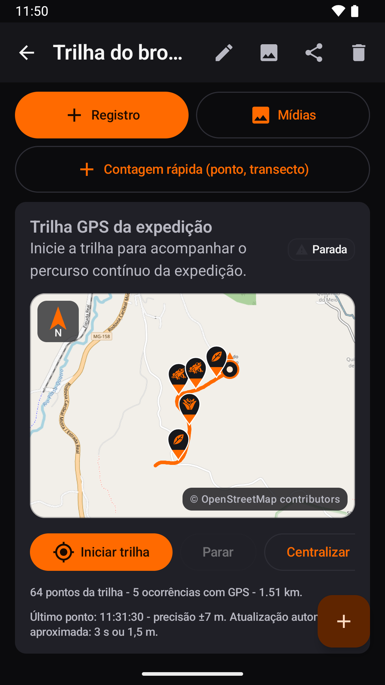
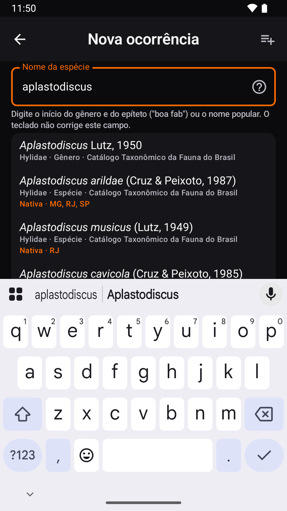
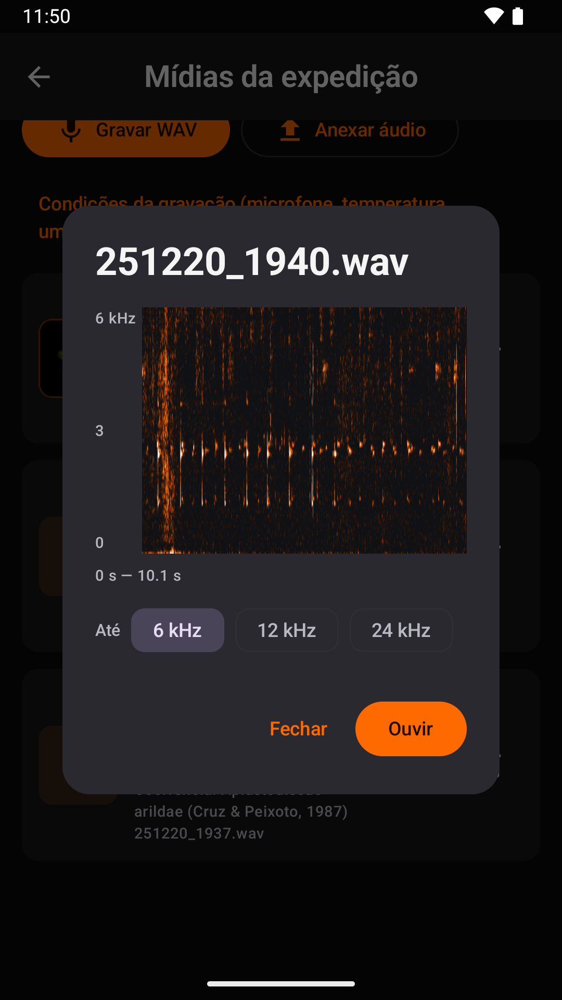

<p align="center">
  <picture>
    <source media="(prefers-color-scheme: dark)" srcset="app/src/main/res/drawable-nodpi/oikos_brand_logo.png">
    
  </picture>
</p>

<p align="center">
  Caderno de campo digital para biodiversidade, para Android.<br>
  Expedições, ocorrências, coordenadas, trilhas, fotos e áudios, sem internet e com exportação em Darwin Core.
</p>

<p align="center">
  <a href="https://github.com/LuanCortesM/oikos-fieldbook/actions/workflows/ci.yml"></a>
  <a href="https://doi.org/10.5281/zenodo.20526746"></a>
  <a href="LICENSE"></a>
</p>

<p align="center">
  <a href="https://play.google.com/store/apps/details?id=com.oikos.fieldbook">Google Play</a> ·
  <a href="https://luancortesm.github.io/oikos-fieldbook/privacidade/">Política de privacidade</a> ·
  <a href="README.en.md">English</a>
</p>

---

O Oikos FieldBook é um caderno de campo para quem levanta fauna, flora e fungos. No campo, você registra a expedição, os indivíduos encontrados, as fotos e as gravações. Depois, exporta tudo em planilha, Darwin Core Archive ou GeoJSON, sem redigitar nada.

O app funciona sem internet e não tem conta nem servidor. Os dados ficam no celular até você decidir para onde mandar.

<p align="center">
  
  
  
  
</p>

## No campo

- **Projetos e expedições.** Cada projeto define os grupos que estuda (fauna, flora, funga) e os campos que vai usar, dentro de um catálogo de mais de 150 termos Darwin Core com vocabulários controlados. A expedição guarda data, local, equipe, ambiente e esforço amostral e corresponde ao `Event` do padrão.
- **Registros.** Ocorrências com espécie, contagem, fotos, áudios e anotações. Há também a contagem rápida, para ponto e transecto.
- **GPS.** O app tira a média de várias leituras e calcula a incerteza. A altitude é convertida para o nível do mar pelo geoide EGM2008, e o município e o estado saem da malha do IBGE, tudo calculado no aparelho. O datum pode ser SIRGAS 2000 ou WGS84, e as coordenadas podem ser vistas e digitadas em graus decimais, GMS, GMD ou UTM.
- **Trilha.** O percurso da expedição continua sendo gravado com a tela apagada. Trilhas de GPS de mão entram por GPX, KML, GeoJSON ou CSV. O mapa vem do OpenStreetMap ou de um arquivo MBTiles, para áreas sem sinal.
- **Fotos e áudio.** A câmera abre dentro do app. O áudio é gravado em WAV sem compressão (44,1 kHz, 16 bits) e pode ser conferido no espectrograma. Fotos e gravações de outros aparelhos podem ser anexadas, e o app lê a data e o modelo da câmera ou do gravador.
- **Listas de espécies sem internet.** A Flora e Funga do Brasil e o Catálogo Taxonômico da Fauna do Brasil vêm dentro do app. Elas sugerem nomes e mostram sinônimos, nomes populares e a distribuição por estado. As listas podem ser atualizadas pelo próprio app.

## Depois do campo

- **Exportação.** O app gera CSV (no padrão internacional ou no do Excel brasileiro), XLSX, JSON e GeoJSON para o QGIS. Também gera um ZIP com as planilhas e as mídias e o Darwin Core Archive (`meta.xml` e `eml.xml`), o formato usado para publicar dados no GBIF e no SiBBr. Medidas extras saem como `MeasurementOrFact`. Em qualquer idioma do app, colunas e vocabulários seguem o padrão Darwin Core.
- **Etiquetas de exsicata** em PDF, com o QR code do registro.
- **Backup e troca entre celulares.** O backup completo (banco, fotos e áudios) vai num só arquivo. Um projeto pode ir para outro celular como arquivo ou direto para o aparelho ao lado, sem internet, e o app mostra antes o que é novo e o que conflita.
- **Lixeira.** O que é apagado fica 30 dias antes de sumir.
- **Citação.** A tela Sobre traz a referência em ABNT, Vancouver e APA, e cada exportação leva um `COMO_CITAR.txt`.
- **Idiomas.** Português, inglês e espanhol.

O app não tem anúncios, análise de uso nem rastreamento. A internet serve só para o mapa online, o download das listas e, se você ligar, a sugestão de endereço pelo Google. Os detalhes estão na [política de privacidade](https://luancortesm.github.io/oikos-fieldbook/privacidade/).

## Instalar

O app está no [Google Play](https://play.google.com/store/apps/details?id=com.oikos.fieldbook) e funciona a partir do Android 8.0. O código deste repositório pode estar um pouco à frente da versão publicada na loja.

## Compilar

Você precisa do JDK 21 ou mais novo (o do Android Studio serve) e do Android SDK 36.

```bash
./gradlew assembleDebug                # APK em app/build/outputs/apk/debug/
./gradlew testDebugUnitTest            # testes de unidade
./gradlew connectedDebugAndroidTest    # testes no emulador ou no celular
```

A versão de loja só é assinada se existir `signing/keystore.properties`, com `storeFile`, `storePassword`, `keyAlias` e `keyPassword`. Sem esse arquivo, o release sai sem assinatura. A pasta `signing/` nunca vai para o repositório.

## Organização do código

Código em Kotlin, telas em Jetpack Compose e banco em Room (SQLite). Fica em `app/src/main/java/com/oikos/fieldbook/`:

| Pasta | O que tem |
|---|---|
| `data` | Banco de dados: entidades, consultas e migrações (os esquemas ficam em `app/schemas`) |
| `dwc` | Catálogo de termos Darwin Core, com rótulos em português, inglês e espanhol |
| `export` | CSV, XLSX, JSON, GeoJSON, ZIP, Darwin Core Archive, etiquetas e citação |
| `services` | GPS, trilha em segundo plano, fotos e áudio, mapa offline, lixeira e troca entre celulares |
| `geo` | Município pela malha do IBGE, geoide EGM2008 e conferência de coordenadas |
| `checklist` | Listas de espécies: leitura, busca, grupos e ícones do mapa |
| `audio` | Espectrograma |
| `backup` | Backup completo do app |
| `ui` | Textos traduzidos, tema e componentes de tela |
| `util` | Coordenadas, idioma e armazenamento |

As telas ficam em `MainActivity.kt`. Os testes estão em `app/src/test` (unidade) e `app/src/androidTest` (aparelho).

## Dados que vêm no app

| Arquivo em `app/src/main/assets` | Fonte | Gerado por |
|---|---|---|
| `municipios.bin` | IBGE, Malha Municipal 2022 (CC BY 4.0) | `tools/ibge/MalhaMunicipal.java` |
| `geoide_egm2008.bin` | Modelo EGM2008 da NGA, a partir da grade de 5' do GeographicLib | `tools/geoide/GeoideEgm2008.java` |
| `listas/flora_brasil.zip` | Flora e Funga do Brasil, JBRJ (CC BY 4.0) | `tools/listas/ListasEmbutidas.java` |
| `listas/fauna_brasil.zip` | Catálogo Taxonômico da Fauna do Brasil (CC BY 4.0) | `tools/listas/ListasEmbutidas.java` |
| `licencas/google_play_services.txt` | Avisos de terceiros do Google Play services | `tools/licencas/AvisosPlayServices.java` |

O começo de cada gerador explica de onde baixar a fonte e como rodar. Os ícones do mapa saem de `tools/icones` e a tela de abertura, de `tools/splash`.

## Como citar

> Maciel, L. S. C. (2026). *Oikos FieldBook* (Version 0.2.4) [Computer software]. Zenodo. https://doi.org/10.5281/zenodo.20526746

O DOI vale para todas as versões e sempre leva à mais recente. A tela Sobre do app traz também a referência em ABNT e Vancouver, já com a data de acesso. O botão "Cite this repository" do GitHub usa o [`CITATION.cff`](CITATION.cff).

## Licença

O código está sob a [licença Apache 2.0](LICENSE).

Ficam fora dela, com todos os direitos reservados ao autor, o nome Oikos FieldBook, o logo e os desenhos do app:

- os logos e ícones em `app/src/main/res/drawable-nodpi/` e `app/src/main/res/drawable/ic_oikos_notification.xml`;
- o trilheiro e o contorno do Itaguaré, em todos os arquivos derivados deles (`app/src/main/res/drawable/trilheiro.xml`, `app/src/main/res/drawable/itaguare_contorno.xml`, `tools/splash/` e `docs/privacidade/.itaguare_path.txt`);
- os desenhos de `tools/icones/desenhos/` e `tools/icones/svg/`;
- as imagens de `docs/`.

Os dados de terceiros que vêm no app seguem as próprias licenças, listadas em [`NOTICE`](NOTICE).

## Problemas e sugestões

Abra uma [issue](https://github.com/LuanCortesM/oikos-fieldbook/issues) ou use o botão "Relatar problema ou dar ideia" do app, que monta um e-mail para herpetomantiqueira@gmail.com.

## Créditos

Desenvolvido por Luan da Silva Cortes Maciel (Maciel, L. S. C.), do Projeto Herpeto Mantiqueira. O app é o produto técnico do mestrado profissional do autor em Biodiversidade em Unidades de Conservação, na Escola Nacional de Botânica Tropical do Instituto de Pesquisas Jardim Botânico do Rio de Janeiro. A orientação é de Leandro Freitas e a coorientação, de Matheus de Toledo Moroti. O app está vinculado à pesquisa "Levantamento e Interações Ecológicas entre Anuros e Bromélias na RPPN Gigante do Itaguaré".

Mapa: © colaboradores do [OpenStreetMap](https://www.openstreetmap.org/copyright).
